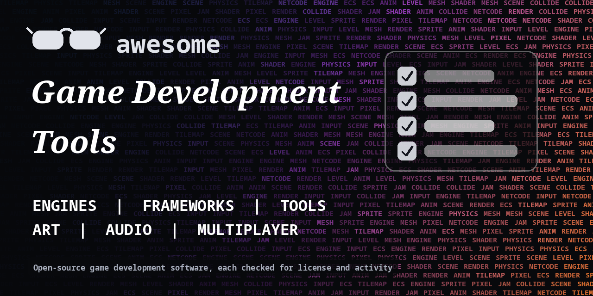

<h1 align="center">Awesome Game Development Tools</h1>

> Open-source engines, frameworks, tools and libraries for making games, from 2D to 3D, plus art, audio and AI helpers. Every entry shows its license.

**Rules of this list:** every repo exists, is public, is not archived, states a license and has had a commit in the last year. One plain sentence each. Star counts and claims are the authors' own, we did not test every tool. Checked 2026-10-18. See [CONTRIBUTING.md](CONTRIBUTING.md).

## Contents

- [Game engines](#game-engines)
- [Frameworks and libraries](#frameworks-and-libraries)
- [Physics, ECS and math](#physics-ecs-and-math)
- [Level and map tools](#level-and-map-tools)
- [Art and animation](#art-and-animation)
- [Game audio and music](#game-audio-and-music)
- [Multiplayer and servers](#multiplayer-and-servers)
- [AI for games](#ai-for-games)
- [Dialogue, UI and tools](#dialogue-ui-and-tools)
- [How to choose](#how-to-choose)
- [Contributing](#contributing)

## Game engines

Full engines with editors.

- [bevyengine/bevy](https://github.com/bevyengine/bevy)  - Data-driven game engine built in Rust. _(Apache-2.0)_
- [cocos/cocos-engine](https://github.com/cocos/cocos-engine)  - Cocos Creator engine for 2D and 3D games. _(check repo)_
- [defold/defold](https://github.com/defold/defold)  - Free game engine for desktop, mobile, web and console. _(check repo)_
- [FlaxEngine/FlaxEngine](https://github.com/FlaxEngine/FlaxEngine)  - Complete 3D game engine with C# and C++ scripting. _(check repo)_
- [godotengine/godot](https://github.com/godotengine/godot)  - Multi-platform 2D and 3D game engine with a built-in editor. _(MIT)_
- [love2d/love](https://github.com/love2d/love)  - LOVE, a 2D game framework for Lua. _(check repo)_
- [o3de/o3de](https://github.com/o3de/o3de)  - Open 3D Engine for games and simulations. _(check repo)_

## Frameworks and libraries

Code-first game libraries.

- [excaliburjs/Excalibur](https://github.com/excaliburjs/Excalibur)  - Friendly TypeScript 2D game engine for the web. _(BSD-2-Clause)_
- [kaplayjs/kaplay](https://github.com/kaplayjs/kaplay)  - Fun JavaScript game library. _(MIT)_
- [libgdx/libgdx](https://github.com/libgdx/libgdx)  - Cross-platform Java game development framework. _(Apache-2.0)_
- [libsdl-org/SDL](https://github.com/libsdl-org/SDL)  - Simple DirectMedia Layer, a cross-platform multimedia library. _(Zlib)_
- [MonoGame/MonoGame](https://github.com/MonoGame/MonoGame)  - Open-source C# framework for cross-platform games. _(check repo)_
- [mrdoob/three.js](https://github.com/mrdoob/three.js)  - JavaScript 3D library. _(MIT)_
- [phaserjs/phaser](https://github.com/phaserjs/phaser)  - Fast, fun HTML5 2D game framework. _(MIT)_
- [pixijs/pixijs](https://github.com/pixijs/pixijs)  - Fast 2D rendering library for the web. _(MIT)_
- [playcanvas/engine](https://github.com/playcanvas/engine)  - WebGL and WebGPU game engine. _(MIT)_
- [raysan5/raylib](https://github.com/raysan5/raylib)  - Simple and easy-to-use library to enjoy videogames programming. _(Zlib)_

## Physics, ECS and math

Core systems.

- [bulletphysics/bullet3](https://github.com/bulletphysics/bullet3)  - Real-time collision detection and multi-physics simulation. _(check repo)_
- [dimforge/rapier](https://github.com/dimforge/rapier)  - Fast 2D and 3D physics engine in Rust. _(Apache-2.0)_
- [erincatto/box2d](https://github.com/erincatto/box2d)  - 2D physics engine for games. _(MIT)_
- [jrouwe/JoltPhysics](https://github.com/jrouwe/JoltPhysics)  - Multi-core friendly rigid body physics and collision library. _(MIT)_
- [SanderMertens/flecs](https://github.com/SanderMertens/flecs)  - Fast entity component system for C and C++. _(check repo)_
- [skypjack/entt](https://github.com/skypjack/entt)  - Fast, header-only C++ entity component system. _(MIT)_

## Level and map tools

Editors for worlds.

- [mapeditor/tiled](https://github.com/mapeditor/tiled)  - Flexible level editor for tile maps. _(check repo)_

## Art and animation

Pixel art, sprites and 3D.

- [blender/blender](https://github.com/blender/blender)  - Free and open-source 3D creation suite. _(check repo)_
- [EsotericSoftware/spine-runtimes](https://github.com/EsotericSoftware/spine-runtimes)  - Runtimes for Spine animations. The editor is paid. _(check repo)_
- [KDE/krita](https://github.com/KDE/krita)  - Free digital painting program. _(GPL-3.0)_
- [LibreSprite/LibreSprite](https://github.com/LibreSprite/LibreSprite)  - Free and open-source sprite editor, a fork of Aseprite. _(GPL-2.0)_

## Game audio and music

Make and play sound.

- [chr15m/jsfxr](https://github.com/chr15m/jsfxr)  - JavaScript sound effect generator. _(Unlicense)_
- [LMMS/lmms](https://github.com/LMMS/lmms)  - Cross-platform music production software. _(GPL-2.0)_
- [mackron/miniaudio](https://github.com/mackron/miniaudio)  - Single-file audio playback and capture library. _(check repo)_

## Multiplayer and servers

Netcode and game servers.

- [colyseus/colyseus](https://github.com/colyseus/colyseus)  - Multiplayer framework for Node.js. _(MIT)_
- [Facepunch/Facepunch.Steamworks](https://github.com/Facepunch/Facepunch.Steamworks)  - Steamworks wrapper for C#. _(MIT)_
- [heroiclabs/nakama](https://github.com/heroiclabs/nakama)  - Distributed server for social and realtime games. _(Apache-2.0)_
- [ValveSoftware/GameNetworkingSockets](https://github.com/ValveSoftware/GameNetworkingSockets)  - Basic transport layer for games. _(BSD-3-Clause)_

## AI for games

NPCs, pathfinding and generation.

- [recastnavigation/recastnavigation](https://github.com/recastnavigation/recastnavigation)  - Navigation mesh construction and pathfinding toolset for games. _(Zlib)_
- [Unity-Technologies/ml-agents](https://github.com/Unity-Technologies/ml-agents)  - Train agents in games and simulations with machine learning. _(check repo)_

## Dialogue, UI and tools

Story and interface tools.

- [dialogic-godot/dialogic](https://github.com/dialogic-godot/dialogic)  - Dialogue, characters and visual novel creator for Godot. _(MIT)_
- [inkle/ink](https://github.com/inkle/ink)  - Narrative scripting language for games. _(MIT)_
- [ocornut/imgui](https://github.com/ocornut/imgui)  - Bloat-free immediate mode GUI for C++. _(MIT)_
- [YarnSpinnerTool/YarnSpinner](https://github.com/YarnSpinnerTool/YarnSpinner)  - Tool for building interactive dialogue in games. _(MIT)_

## How to choose

- **Check the license** of an engine before you ship and sell a game.
- **Start with a tiny game** and finish it.
- **Credit asset authors** and keep records.
- **Console export** often needs extra steps or fees.

## Contributing

See [CONTRIBUTING.md](CONTRIBUTING.md). One entry per pull request, plain words, real sources only.

## About

Maintained by [@devanasolver](https://github.com/devanasolver). Listings follow the rules in CONTRIBUTING.

## Sponsor me

If this list is useful, [buy me a coffee](https://buymeacoffee.com/isaac49).
